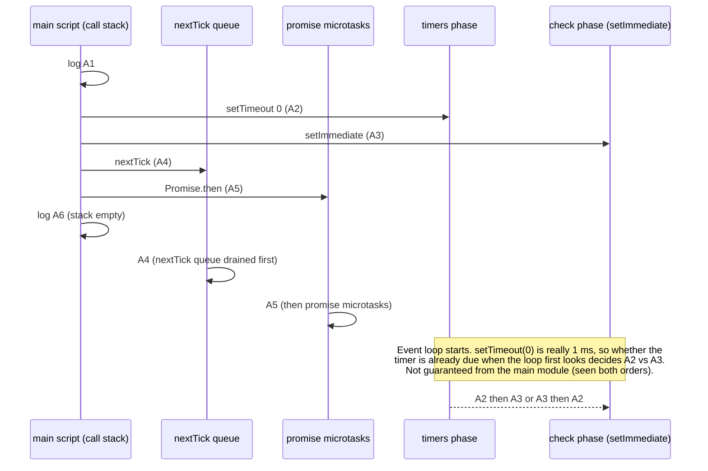
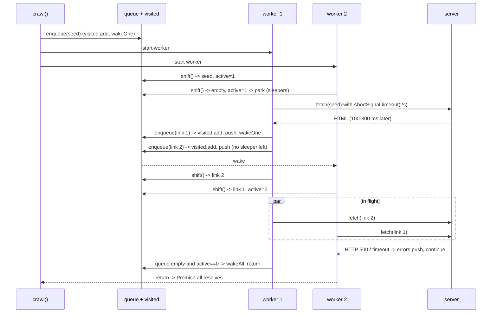
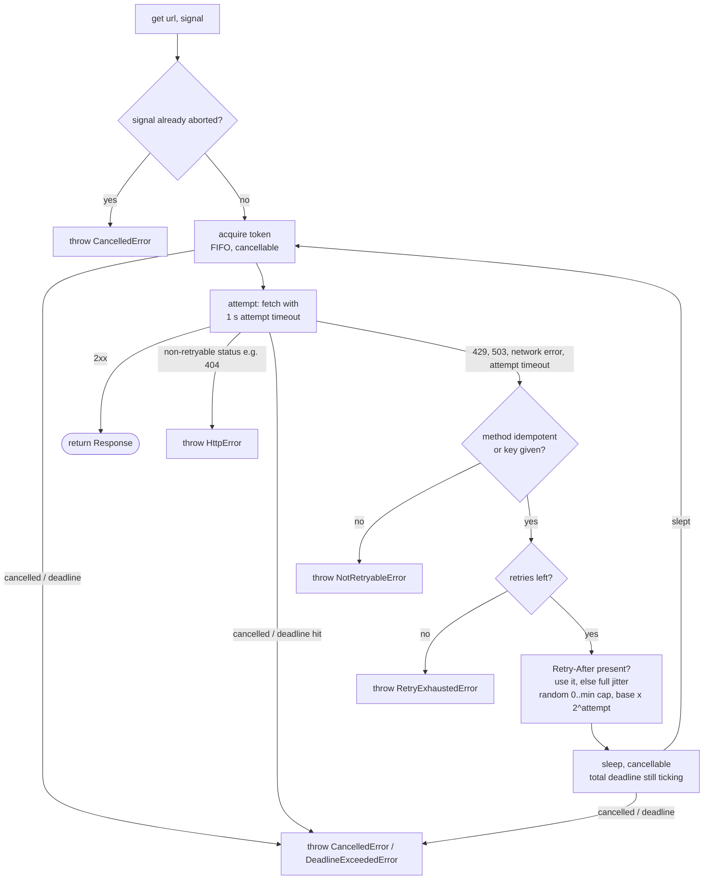

# Lab 2 — Async/Await & Promise-Based Programming (RCAP-401, Chapter 2)

Environment: Windows 11, Node.js v23.4.0, Python 3.13.7 + aiohttp, 8 logical cores / 17 GB RAM.
Everything (load generator included) runs on the same machine, so absolute numbers are indicative; the *shapes* are what matter.
All numbers below come from files in this ZIP (`crawler/results.json`, `api-client/verify-results.json`, `bonus/results.json`, logs).

---

## 0. Warm-up — predicted vs observed

| Snippet | Predicted | Observed (3 runs) |
|---|---|---|
| A | `A1 A6 A4 A5` then `A2`/`A3` in either order | `A1 A6 A4 A5 A3 A2`, `A1 A6 A4 A5 A3 A2`, `A1 A6 A4 A5 A2 A3` |
| B | `B1 B3 B4 B2` | `B1 B3 B4 B2` |
| C | `C1 C3 C2 C4` | `C1 C3 C2 C4` |



* **A** — synchronous code first (A1, A6). When the stack empties Node drains `process.nextTick` *before* promise microtasks (A4, A5). The two macrotasks (A2, A3) race: `setTimeout(0)` is clamped to 1 ms, so it depends on whether 1 ms has elapsed when the loop enters the timers phase. Inside an I/O callback `setImmediate` would always win (check phase directly follows poll).
* **B** — `f()` runs synchronously up to its first `await` (B1), calls `g()` which runs synchronously (B3), and `await` yields even for an already-resolved promise, so control returns to the caller (B4) and the continuation (B2) runs as a microtask.
* **C** — `gather` starts both coroutines as tasks; each runs until `await asyncio.sleep(0)`, which yields to the loop once, so the two interleave: C1 C3 C2 C4.

Sources: `warmup/a.js`, `b.js`, `c.py`.

---

## 1. Crawler (`crawler/`)

Mock site: 200 pages (binary tree: page *n* links to 2n+1 and 2n+2), 100–300 ms latency (mean ≈ 200 ms). The whole tree is 8 levels deep, so `maxDepth = 10` crawls all of it.

### 1.1 Sequential vs naive vs bounded (200 pages)

| Strategy | Total time | Peak in-flight | Errors | Pages OK |
|---|---|---|---|---|
| Sequential (`for` + `await`) | **44.5 s** | 1 | 0 | 200 |
| Naive `Promise.all` | **2.03 s** | 64 | 0 | 200 |

### 1.2 Bounded worker pool — N sweep (task 3)

| N | Total time | Peak in-flight | Errors | Pages OK |
|---|---|---|---|---|
| 1 | 41.02 s | 1 | 0 | 200 |
| 5 | 8.95 s | 5 | 0 | 200 |
| 20 | 2.80 s | 20 | 0 | 200 |
| 50 | 2.08 s | 50 | 0 | 200 |

Reading: time ≈ 200 pages × 0.2 s / N while N is small (41 s → 9 s → 2.8 s). At N = 50 we are almost at the naive time (2.03 s): the floor is the **critical path** — 8 tree levels × ~250 ms (the slowest sibling of each level) — not the number of workers, so more concurrency stops paying off. The Python port (asyncio + aiohttp + `Semaphore`) gives the same shape: N = 20 → 2.91 s (peak 20), N = 5 → 8.54 s (peak 5), 200/200 OK (`crawler/python-output.txt`).

### 1.3 What breaks with the naive version? (task 2)

| Site size | Naive result | Bounded (N = 50) |
|---|---|---|
| 200 pages | 2.0 s, 0 errors, peak 64 | 2.08 s, peak 50 |
| 2,000 pages | 5.2 s, **0 errors**, peak **611** in flight (server saw ≤ 206 at once) | 9.5 s, 0 errors, peak 50 |
| 20,000 pages | 8.9 s, **2,432 timeouts**, peak **2,637** in flight, crawl abandoned with 5,473 pages OK / 7,905 discovered | (not run) |

Honest note: at 2,000 pages the naive crawler did **not** fail on this machine — Node/undici and the OS queued the surplus sockets and everything finished in time. It is a *capacity* problem, not a correctness one, and it appears when the queue wait exceeds the 2 s timeout: at 20,000 pages 2,637 requests were launched at once, the server only handled ~400 concurrently, the rest sat in connection queues and were aborted by their timeout. On other setups the same code hits `EMFILE`/"too many open files", `ECONNRESET`, rate-limit bans (429) or server overload. There is also no back-pressure at all: memory (one promise + socket buffers per URL) grows with the *frontier* size, not with the work in progress. The bounded pool did 2,000 pages with exactly 50 sockets and zero errors (9.5 s ≈ 2,000 × 0.2 / 50 = 8 s + overhead).

### 1.4 Visited set (task 4)
`enqueue()` does `if (visited.has(url)) return; visited.add(url); queue.push(...)` with **no `await` between the check and the insert**. JavaScript only switches tasks at `await`/callbacks, so no other worker can run in the middle: each URL is fetched exactly once (verified: `visited == pages OK + errors` on every run). In Java with real threads two threads can both see `contains(url) == false` and then both insert (check-then-act race); you would need `ConcurrentHashMap.add`/`putIfAbsent` or a lock. The JS guarantee is *only* about the synchronous segment — see reflection Q2 for what is still unsafe.

### 1.5 Error isolation (task 5)
Mock configured with page 7 → HTTP 500 and page 12 → never responds. Bounded crawler (N = 20, `AbortSignal.timeout(2000)`):

```
isolation: 2.74 s, ok=154, errors=2, peak=20
  { url: /7,  error: 'HTTP 500' }
  { url: /12, error: 'timeout' }
```
The crawl finished (2.74 s ≈ the 2 s timeout + normal latency, no hang). 154 pages instead of 200: the two failed pages and their 44 descendants are unreachable by construction (the links were never read). The 500 response body is cancelled (`res.body.cancel()`) so the socket returns to the pool; the hung request is aborted by the signal, which closes the socket (no hang, the process exits normally).

### 1.6 Sequence of events (bounded crawler)



The `setTimeout(10)` polling of the starter was replaced by a list of parked resolvers (`sleepers`): a worker with nothing to do sleeps on a promise that `enqueue()` or the last finishing worker resolves, so there is no polling and no idle wake-ups.

---

## 2. Resilient API client (`api-client/`)

Files: `src/token-bucket.js`, `src/client.js`, `src/errors.js`, `src/clock.js` (real + `FakeClock`), `test/*.test.js`, `verify.js`.

### 2.1 Design
* **Token bucket** — lazily refilled (`tokens += elapsed × rate`, no `setInterval`), capacity = burst, strict FIFO queue of waiters, **one** timer that exists only while someone waits and is cleared when the queue empties or its last waiter cancels. Newcomers never jump the queue.
* **Per call**: one `AbortController` owns the whole call. Caller `AbortSignal` and the **total deadline** (default 5 s, armed when the first token is obtained; `countQueueTime: true` counts the initial queue wait too) both abort it. Token wait, backoff sleep and the in-flight `fetch` all listen to it, so cancelling stops all three. Each attempt also gets its own **1 s timeout**.
* **Retry only** on 429/503 (configurable), network errors and attempt timeouts. `Retry-After` (seconds or HTTP-date) overrides the computed delay. Otherwise **full jitter**: `sleep = random() × min(cap, base × 2^attempt)`. Each retry **pays for a new token**.
* **Idempotency guard**: POST/PATCH are retried only with `idempotencyKey` (sent as `Idempotency-Key`, identical on every attempt). Otherwise `NotRetryableError`.
* **Typed errors**: `CancelledError`, `DeadlineExceededError`, `RetryExhaustedError`, `HttpError` (non-retryable status, e.g. 404), `NotRetryableError`. `get()` resolves only for 2xx.
* **Everything time-related is injected** (`clock`, `random`, `fetch`), which is what makes the tests deterministic.

### 2.2 Retry flow



### 2.3 Tests (`npm test`, fake clock)
**30 tests, 30 pass, 0.33 s total** (each test runs seconds of "virtual" time in ~1–20 ms). Covered: burst/refill/idle cap, 300 concurrent callers in strict FIFO order with the 1 s-window maximum ≤ burst + rate, queue-jumping, waiter cancellation, exact backoff schedule (`[0, 50, 150, 350, 600]` ms with `random = 0.5`), `Retry-After: 2` ⇒ exactly 2000 ms, attempt timeout aborts the fetch, total deadline, cancellation in the token wait / backoff / in-flight, 100 calls cancelled at once leaving `clock.pending === 0`, POST with/without key, 404 not retried. Every cancellation test asserts that **no timer is left** in the fake clock.

### 2.4 Verification scenario — 100 concurrent `get()` at 10 rps (`node verify.js`, real clock/sockets)
Mock API: 30 % failures = 10 % 429 (`Retry-After: 1`), 10 % 503, 10 % hang.

| Run | Elapsed | Outcomes | Attempts that reached the server (retries) | Max requests in any 1 s window | Active `Timeout` handles after run |
|---|---|---|---|---|---|
| Default config (deadline 5 s) | **12.16 s** | 81 OK, 18 `DeadlineExceeded`, 1 `RetryExhausted` | 124 (**24 retries**) | **20** | **0** |
| Deadline raised to 30 s | 12.10 s | **100 OK** | 127 (27 retries) | 20 | 0 |
| Cancel at t = 2.5 s | 2.52 s | 24 OK, 76 `CancelledError` | 34 | 20 | **0** (and `getActiveResourcesInfo()` after `server.close()` = only 2 `PipeWrap`, no timers/sockets) |

(Run-to-run variance ±3 calls since failures are random; the first execution gave 84 OK / 15 deadline / 1 exhausted.)

Reading:
* **Elapsed ≥ 10 s, not 1 s** ✔: 90 requests beyond the burst at 10/s ⇒ ≥ 9 s, plus the retries (they also consume tokens) ⇒ 12 s.
* **Max in a 1 s window = 20** = rate (10) + burst (10): the theoretical worst case of a token bucket (a full bucket of 10 plus 10 refilled during the same second). The *average* over the run is 10/s (127 attempts / 12.1 s ≈ 10.5/s).
* **Why 18 deadline failures with the default 5 s?** Retries re-enter the *back* of the FIFO limiter queue, behind up to ~90 callers waiting for their first attempt (≈ 9 s of queue). A retry that must wait longer than what remains of its 5 s budget dies by deadline. This is the cost of fairness plus a hard deadline on a saturated limiter, not a bug: with a 30 s budget all 100 succeed. A possible refinement (not done, would break strict FIFO) is to give retries priority over new callers.
* **Dangling timers**: 0 in every scenario, thanks to clearing the limiter timer when the queue empties, `clearTimeout` of attempt/deadline timers in `finally`, and removing abort listeners.
* A `MaxListenersExceededWarning` appeared when 100 calls shared one `AbortSignal`; that is expected (each call attaches a listener, and removes it when done), so `verify.js` raises the limit for that signal.

---

## 3. Bonus — 10,000 concurrent requests & loop lag (`bonus/`)

`autocannon` (single Node process) runs on the same machine as the server, so it is also a bottleneck.

### 3.1 Part A — throughput (`autocannon -c 10000 -d 20`, handler `await sleep(50)`)

| Metric | Value |
|---|---|
| Requests/s (avg) | 1,277 (17,871 requests in 20 s) |
| Latency p50 / p99 | 15.3 s / 17.3 s |
| Errors / timeouts | 1,844 / 0 (autocannon does not break the errors down; they appear only in the connect storm) |
| Memory (RSS) | 52 MB idle → **128 MB** after 10,000 connections (≈ 7.6 KB per connection) |
| OS threads | **13 at idle and 13 at peak** (Windows `Get-Process … Threads.Count`): same 13 with 10,000 live connections |
| Loop lag | 94 warnings, max 354 ms (the accept/connect storm itself) |

Interpretation: **10,000 simultaneous connections cost 76 MB and zero extra threads** — the event loop's strength. But the throughput/latency here are *not* the server's real limit: a single-threaded load generator is the ceiling (even with only 100 connections the same machine gave ≈ 1.6k rps, Part B baseline). With a closed loop (every connection resends when answered) Little's law gives latency ≈ connections / throughput = 10,000 / 1,277 ≈ 7.8 s, and p50 = 15 s also includes connection set-up queueing. A cross-check with `autocannon workers: 6` (`partA-workers.js`) did not help: it saturated the 8-core host (40,790 errors), so it is **not** a valid measurement and only kept for transparency. A fair test needs a separate load-generator machine (and on Linux `ulimit -n` ≥ 10,000). I also had to raise the server's `listen` **backlog** (default 511 dropped SYNs: the first attempt gave 20,000 timeouts and 0 requests).

### 3.2 Part B — blocking the loop (`/` under 100 connections for 16 s, `/cpu` = fib(35) ≈ 160 ms, hit 3 times at t = 4, 8, 12 s)

| Scenario | `/` rps | `/` p50 | **`/` p99** | `/` max | max loop lag | lag warnings (> 20 ms) | `/cpu` response times |
|---|---|---|---|---|---|---|---|
| Baseline (no `/cpu`) | 1,639 | 58 ms | **91 ms** | 220 ms | 24 ms | 1 | — |
| **Before** — `/cpu` inline | 1,545 | 59 ms | **184 ms** | 312 ms | **150 ms** | 7 | 237, 218, 165 ms |
| **After** — worker pool (6) | 1,603 | 59 ms | **92 ms** | 234 ms | 31 ms | 2 | 473, 598, 748 ms |

p99 of `/` while `/cpu` is being called: **184 ms → 92 ms** (back to the 91 ms baseline). The 50 ms handlers are normally ~60 ms; while fib runs inline *every* request waits behind it (all 100 in-flight requests are stalled for ~150 ms), which is exactly what the p99 and the lag log show.

Loop-lag log excerpt (`bonus/lag-inline.log`, **before**; the 150/139/107 ms lines are the three `/cpu` calls):
```
2026-11-16T14:06:02.801Z event-loop lag 150 ms
2026-11-16T14:06:07.016Z event-loop lag 139 ms
2026-11-16T14:06:11.193Z event-loop lag 107 ms
```
After (`bonus/lag-worker.log`): only
```
2026-11-16T14:06:16.650Z event-loop lag 27 ms
2026-11-16T14:06:20.873Z event-loop lag 31 ms
```
(the 20–30 ms entries also appear in the baseline: GC/scheduling noise on a machine that is also running the load generator).

Trade-off: the `/cpu` call itself got **slower** with workers (≈ 160 ms inline → 470–750 ms) because the 8 cores are fully used by autocannon + server + workers on this laptop, and there is message-passing cost; but the *other* 1,600 requests per second stopped paying for it. Memory also rose (≈ 68 → 119 MB: 6 extra V8 isolates).

### 3.3 Hint check: pool smaller than the number of concurrent `/cpu` calls

6 simultaneous `/cpu` calls × 3 rounds, `/` under load throughout:

| Pool size | `/` p99 | `/cpu` latencies seen (ms, 18 calls) | max loop lag |
|---|---|---|---|
| 2 | 90 ms | 444 … **1,590** (spread out in waves) | 33 ms |
| 6 | 95 ms | 347 … 788 | 31 ms |

With a pool of 2, the 6 jobs queue (3 "waves"), so the *slowest `/cpu` call is ≈ 2× longer than with a pool of 6* — the queueing delay mentioned in the hints. Importantly `/` is untouched either way: the queue lives inside the pool, not in the event loop.

---

## 4. Reflection

**1. Why can `await` in a `for` loop make code 100× slower, and when is it required?**
`await` suspends the loop until the previous request finishes, so N independent 200 ms requests cost N × 200 ms instead of ≈ 200 ms in total (measured here: 44.5 s sequential vs 2 s concurrent for 200 pages ≈ 22×; the factor grows with the number of items up to the point where the server or sockets become the limit — 100× at ~100 items/level). It is **required** when iteration *k+1* depends on the result of *k* (pagination cursors, a transaction's ordered statements), when order of side effects matters (appending to a file, ordered messages), or when you must bound concurrency/rate and a simple sequential loop is acceptable. Otherwise start the operations first and await together (`Promise.all`, or a bounded pool).

**2. A logic race with no data race.**
```js
async function withdraw(acct, amount) {
  const balance = await db.getBalance(acct);      // await 1
  if (balance >= amount) await db.setBalance(acct, balance - amount); // await 2
}
await Promise.all([withdraw(a, 80), withdraw(a, 80)]); // balance 100 -> both read 100, both write 20
```
Each statement is atomic, but between the two awaits other tasks run, so a decision taken from stale data (“balance ≥ amount”) is applied later. The crawler's `visited` check is safe *only* because check and insert have no `await` between them; had I written `if (!visited.has(u)) { await log(u); visited.add(u); }` it would break. Fixes: re-check after the await, make the read-modify-write one atomic operation (DB `UPDATE … WHERE balance >= ?`), or serialise per account with a queue/mutex.

**3. What happens to a pending request on cancel? Whose job is it to free the socket?**
Cancelling only *signals* intent: `signal.abort()` makes the `fetch` promise reject with an `AbortError`; the server may still process the request (cancel ≠ undo — hence the idempotency key for writes). Freeing the socket is the job of the **HTTP client library** (undici closes/destroys the connection on abort), *provided* the caller passed the signal down; the caller's job is to propagate the signal and to consume or cancel response bodies (`res.body.cancel()`), because an unread body pins the socket. In my client the same abort also cancels the token wait and the backoff sleep and clears every timer (verified: 0 active timers, no leftover sockets after `server.close()`).

**4. Node's event loop vs Java 21 virtual threads.**
Both give cheap concurrency for I/O-bound work with few OS threads (here: 10,000 connections on 13 threads, +76 MB). The event loop needs a *colour-coded* async style (`async`/`await` everywhere), has one JS thread so CPU work blocks everyone (Part B) and needs workers/processes; no data races, but logic races (Q2). Virtual threads let you write ordinary blocking code, use all cores and still handle 100k blocked tasks, so CPU-heavy or mixed workloads and existing blocking libraries (JDBC) fit better — but shared mutable state needs real synchronisation (the visited-set race of 1.4), pinned carriers (`synchronized`, native calls) can starve the scheduler, and cancellation is cooperative (interrupts) rather than first-class. Pick Node for glue/IO-heavy gateways, BFFs, and teams already in JS/TS with a shared type system; pick virtual threads for JVM services, CPU+IO mixes, and when you want simple sequential code over blocking APIs.

**5. Back-pressure when URLs are discovered faster than they are fetched.**
Never let the frontier be an unbounded array. Options: (a) **bounded queue** — `enqueue()` returns a promise that resolves when there is room, so the producer `await`s and slows down; (b) pull-based design: workers *pull* from an async iterator/generator of URLs instead of the parser pushing; (c) priority + dedupe + cap: drop or defer the lowest-value URLs (deeper, lower rank) when the cap is reached, spill to disk/DB beyond memory; (d) per-host rate limit/politeness (reuse the token bucket); (e) signals upstream: pause parsing when `queue.length > highWatermark`, resume under a low watermark (Node streams `highWaterMark`/`drain` model). The bounded pool already limits *in-flight* work; back-pressure limits the *waiting* work.

**6. A promise is one future value — what models "a price update every 100 ms forever"?**
A *stream* of values over time: an **async iterable** (`for await (const p of prices())`, `async function*`), an Observable/event emitter, or a Node `Readable` stream. It needs: multiple values, completion and error signalling, **cancellation/unsubscribe**, and **back-pressure** (what if the consumer is slower than 100 ms: buffer, drop latest, conflate?), plus multicasting/replay semantics if several consumers listen. A promise can't do any of those: it resolves exactly once and cannot be reset.

---

## 5. How to reproduce
```
warmup/        node a.js ; node b.js ; py c.py
crawler/       node mock-server.js           (terminal 1)
               node bench.js                 (everything, ~1.5 min)   |  node bench.js quick
               node naive-stress.js 20000    (what breaks naive)
               py crawler.py http://localhost:4000/0 --depth 10 --concurrency 20
api-client/    npm test                      (30 tests, fake clock, < 1 s)
               node verify.js                (100 concurrent calls, ~40 s)
bonus/         npm install ; node bench.js   (~3 min)   |  node partA-workers.js 6
```
